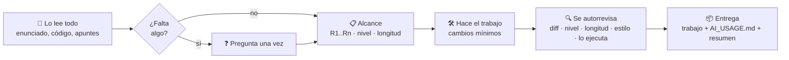

<div align="center">


<br>

[](#-instalación)
[](https://github.com/cheatsheet-skill/cheatsheet/releases/latest/download/cheatsheet.skill)
[](LICENSE)


[](https://github.com/cheatsheet-skill/cheatsheet/stargazers)

**[🇬🇧 Read in English](README.md)**

</div>

---

> **Le pasas la práctica y te devuelve un trabajo que parece hecho por ti en un buen día, no por un chatbot.**
> El mismo código de partida, el estilo del profe, el nivel de tu curso y exactamente lo que se pide. Y un `AI_USAGE.md` honesto declarando el uso de IA, siempre.

Si le pides a una IA cualquiera "hazme la práctica", salen siempre los mismos ocho problemas:

| 😬 Lo que suele hacer la IA | ✅ Lo que hace CheatSheet |
|---|---|
| Reescribe el código del profe y le cambia los nombres a todo | **Cambio mínimo.** Solo se tocan las líneas que pide el enunciado. Un script revisa cada cambio. |
| Añade tests, validaciones, README, apartados "extra" | **Lista cerrada de requisitos.** Cada cambio sale de una frase del enunciado. |
| Convierte "mide el speed-up" en una campaña de benchmarks con 40 ficheros | **Método a escala de estudiante.** Las entradas, ejecuciones y fuentes que dice el enunciado, una sola vez, como lo haría un alumno. |
| Usa ternarios, lambdas y librerías que no habéis visto | **Nivel del curso.** Solo lo que aparece en tus apuntes y en los ejemplos de clase. |
| Explica y justifica cada decisión, como si el profe fuera un revisor desconfiado | **Responde, no se defiende.** El informe explica lo que pide el enunciado; las explicaciones para *ti* van en el chat y en la guía. |
| Mete todos los nombres, cifras y citas de la lectura en un argumento de seminario de máster | **Profundidad de un alumno típico.** Las ideas principales de la lectura, una o dos razones por pregunta y un presupuesto de densidad que comprueba un script, calibrado con entregas reales de alumnos anteriores a la IA. |
| Escribe 3 páginas cuando pedían 1 | **Presupuesto de longitud.** Contado, no a ojo. |
| "Cabe destacar que… desempeña un papel fundamental…" | **Reglas de escritura reales** (ES / CA / EN) basadas en investigación publicada sobre texto de IA. |
| Esconde que se ha usado IA | **`AI_USAGE.md` siempre.** Una declaración clara para entregar según la política de tu asignatura. |

## ✨ Qué puede hacer

- 💻 **Prácticas de programación**: C, Python, Java… Edita sobre el fichero, respeta nombres, sangría y comentarios del profe, ejecuta el código y compara la salida.
- 📝 **Ensayos, informes, memorias y preguntas cortas**: a partir de *tus* apuntes, con la longitud correcta y sin introducciones de relleno ni conclusiones con moraleja.
- 🧮 **Problemas de mates y física**: la misma notación y métodos que en clase, con los pasos que enseña el profe.
- 📊 **Hojas de cálculo**: las fórmulas del curso (en el idioma del Excel), no BUSCARX/LAMBDA si no las habéis visto.
- 🎞️ **Presentaciones, 🧩 diagramas (UML, ER, draw.io, Mermaid), 🎨 dibujo y diseño, 📦 proyectos con varias entregas.**
- 🎓 **Guía interactiva opcional**: un único `.html` que funciona sin internet, te enseña el tema desde cero y te lleva paso a paso hasta el resultado exacto que entregas, con tests, diffs antes/después y preguntas de "predice y comprueba". Ideal para defensas orales.

## 🚀 Instalación

### Claude.ai / app de escritorio de Claude

1. **[Descarga `cheatsheet.skill`](https://github.com/cheatsheet-skill/cheatsheet/releases/latest/download/cheatsheet.skill)**
2. Ve a **Ajustes → Capacidades → Skills** y sube el archivo.
3. Abre un chat y pásale tu práctica. Ya está.

### Claude Code: como plugin (un comando)

```bash
/plugin marketplace add cheatsheet-skill/cheatsheet
/plugin install cheatsheet@cheatsheet
```

### Claude Code: a mano

```bash
git clone https://github.com/cheatsheet-skill/cheatsheet.git
cp -r cheatsheet/skills/cheatsheet ~/.claude/skills/
```

## 💬 Cómo se usa

Háblale a Claude con normalidad y adjunta tus archivos. No hace falta nombrar la skill.

```text
Hazme la práctica 5. Te paso el enunciado y el código del profe.
```
```text
Solo el ejercicio 3. El profe quiere que usemos pthreads.
```
```text
Fes l'activitat del tema 3, 2 pàgines, amb els meus apunts.
```

Si falta algo importante (formato de entrega, versión del lenguaje, tus medidas del laboratorio…), pregunta **una sola vez**, en un solo mensaje, y se pone a trabajar.

## ⚙️ Cómo funciona



Cada entrega incluye:

1. **La actividad terminada**, en su formato y carpeta originales.
2. **`AI_USAGE.md`**: qué herramienta se ha usado, qué ha hecho la IA y qué deberías entender antes de entregar.
3. **Un resumen cambio a cambio**: cada línea o apartado tocado y a qué requisito responde, para que puedas explicarlo.

## 🧰 Herramientas incluidas

Todos los scripts usan **solo la librería estándar de Python 3**; no hay nada que instalar.

| Script | Qué hace |
|---|---|
| `snapshot.py` | Copia el material de partida antes de tocar nada. |
| `review_changes.py` | Diff de código/texto y comparación por párrafo, estilo y celda para `.docx` / `.xlsx` / `.pptx`. Marca los cambios de solo espacios, solo comentarios o renombrados. |
| `text_check.py` | Detecta vocabulario y construcciones típicas de IA (ES / CA / EN), exceso de formato, frases de longitud uniforme, textos más densos en nombres, cifras y citas de lo que escriben los alumnos reales y metadatos sobrantes; cuenta palabras y páginas. |
| `clean_metadata.py` | Limpia las propiedades por defecto ("generated by python-docx") de los archivos creados desde cero. |

## 🧪 Probada con evals

La carpeta [`evals/`](skills/cheatsheet/evals) tiene casos reales con sus correctores:

- **`threads-minimal-diff`**: paralelizar un programa en C con pthreads; el diff solo puede contener el paralelismo.
- **`first-year-level`**: práctica de Python de primero; nada por encima del nivel del curso.
- **`history-essay-two-pages`**: ensayo de 2 páginas a partir de apuntes; prosa, sin marcas de IA, longitud correcta.
- **`ambiguous-asks-first`**: petición vaga; tiene que hacer las preguntas correctas en un solo mensaje.
- **`reading-response-depth`**: aportación a un foro de primero sobre una lectura; 1-2 párrafos, la idea principal en vez de todas las cifras, sin crítica de fuentes y con un ejemplo cotidiano.
- **`speedup-student-scale`**: paralelizar y medir el speed-up; solo las configuraciones pedidas, una tanda de ejecuciones, sin herramientas de benchmark y una memoria breve que no sobrejustifica.

## 🤝 Honesta por diseño

CheatSheet está pensada para ser **transparente**, no para engañar:

- El uso de IA **siempre se declara** en `AI_USAGE.md`, que entregas con el trabajo según la política de tu asignatura.
- **No ayuda en exámenes en curso** o vigilados; en su lugar se ofrece a ayudarte a estudiar.
- **Nunca se inventa** datos de laboratorio, encuestas, citas, experiencias personales ni bibliografía: pregunta o deja un hueco marcado.
- **Nunca mete errores falsos.** Buena escritura, no trucos.
- La guía interactiva y el resumen de cambios están para que **entiendas y puedas defender** cada línea.

**Revisa las normas de tu asignatura sobre IA antes de entregar.** Lo que entregas es responsabilidad tuya.

## 📁 Estructura del repositorio

```
.
├── skills/cheatsheet/        # la skill (SKILL.md, referencias, scripts, plantillas, evals)
├── dist/cheatsheet.skill     # skill empaquetada, lista para subir
├── .claude-plugin/           # manifiesto de plugin y marketplace para Claude Code
└── docs/                     # imágenes del README
```

## 🌟 ¿Te ha servido?

Si CheatSheet te ha salvado un fin de semana, **[deja una ⭐](https://github.com/cheatsheet-skill/cheatsheet/stargazers)**: así la encuentran más estudiantes. Issues y PRs (más idiomas en las reglas de escritura, nuevos tipos de actividad, más evals) son bienvenidos.

<div align="center">

Hecha para estudiantes, con ☕ y Claude. Licencia [MIT](LICENSE).

</div>
