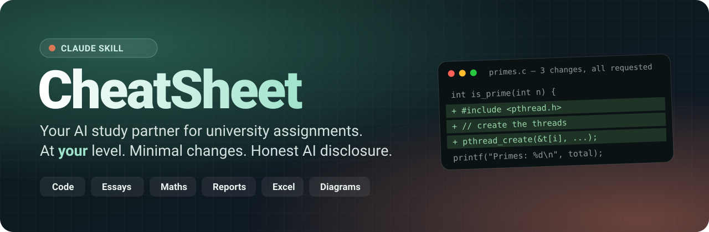
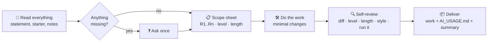

<div align="center">



<br>

[](#-install)
[](https://github.com/cheatsheet-skill/cheatsheet/releases/latest/download/cheatsheet.skill)
[](LICENSE)


[](https://github.com/cheatsheet-skill/cheatsheet/stargazers)

**[🇪🇸 Spanish version](README.es.md)**

</div>

---

> **Drop in your assignment. Get back work that looks like *you* did it on a good day — not like a chatbot did it.**
> Same starter code, same teacher style, same course level, exactly what was asked. And an honest `AI_USAGE.md` declaring the AI use, every single time.

Ask a generic AI to "do my practical" and you get the same eight problems every time:

| 😬 What AI usually does | ✅ What CheatSheet does |
|---|---|
| Rewrites your teacher's starter code, renames everything | **Minimal diff.** Only the lines the task needs change. A script checks every hunk. |
| Adds tests, validation, README, "bonus" sections | **Closed requirements list.** Every change traces to a line in the statement. |
| Turns "measure the speed-up" into a 40-file benchmark campaign | **Student-scale method.** The inputs, runs and sources the statement names, done once, the way a student would. |
| Uses ternaries, lambdas, libraries you haven't seen | **Level calibration.** Only constructs from *your* course notes and examples. |
| Explains and defends every decision, as if the teacher were a sceptical reviewer | **Answers, doesn't defend.** The report explains what the statement asks; the explanations for *you* go in the chat and the guide. |
| Packs every name, figure and quote from the reading into an argument worthy of a seminar | **Depth of a typical student.** The reading's main points, one or two reasons per question, a density budget checked by script and calibrated on real pre-AI student posts. |
| Explains each lab result with every mechanism it knows, writes every constraint in full | **Technical depth of a typical student.** Each result with its main cause in the words of the slides; exercise sheets answered like the teacher's solutions. Calibrated on real second-year practicals. |
| Writes 3 pages when you were asked for 1 | **Length budget.** Counted, not estimated. |
| "It is important to note that… plays a pivotal role…" | **Real writing rules** (English, Spanish, Catalan) based on published research on AI-style text. |
| Hides that AI was used | **`AI_USAGE.md` always.** A clear declaration you submit following your course's policy. |

## ✨ What it can do

- 💻 **Programming practicals** — C, Python, Java… edits in place, keeps the teacher's naming, indentation and comments, runs the code and compares output.
- 📝 **Essays, reports, lab write-ups, short answers** — grounded in *your* notes, right length, sentence-case headings, no filler intros or tidy moral conclusions.
- 🧮 **Maths & physics problem sets** — same notation and methods as the class, steps at the level the teacher shows.
- 📊 **Spreadsheets** — formulas the course uses (in the workbook's language), not XLOOKUP/LAMBDA if you haven't seen them.
- 🎞️ **Presentations, 🧩 diagrams (UML, ER, draw.io, Mermaid), 🎨 drawings & design, 📦 multi-part projects.**
- 🎓 **Optional interactive HTML guide** — one offline file that teaches the topic from zero and walks step by step to the exact result you're submitting, with quizzes, before/after diffs and "predict, then reveal" checks. Perfect for oral defences.

## 🚀 Install

### Claude.ai / Claude desktop app

1. **[Download `cheatsheet.skill`](https://github.com/cheatsheet-skill/cheatsheet/releases/latest/download/cheatsheet.skill)**
2. Go to **Settings → Capabilities → Skills** and upload the file.
3. Start a chat and drop in your assignment. That's it.

### Claude Code — as a plugin (one command)

```bash
/plugin marketplace add cheatsheet-skill/cheatsheet
/plugin install cheatsheet@cheatsheet
```

### Claude Code — manual

```bash
git clone https://github.com/cheatsheet-skill/cheatsheet.git
cp -r cheatsheet/skills/cheatsheet ~/.claude/skills/
```

## 💬 How to use it

Just talk to Claude normally and attach your files. You don't need to name the skill.

```text
Do lab 5 for me. Here's the statement and the teacher's starter code.
```
```text
Do exercise 3 only. The teacher wants us to use pthreads.
```
```text
Write the unit 3 essay, 2 pages, using my class notes.
```

Before starting it always sends **one** message: it asks whether you want the interactive guide and, if something important is missing (the teacher's skeleton, your simulator or lab results, the topic notes, delivery format…), asks for it in the same message. Then it waits for your answer. The guide is only built if you say yes.

## ⚙️ How it works



Every delivery includes:

1. **The finished activity**, in its original format and folder.
2. **`AI_USAGE.md`** — what tool was used, what the AI did, what you should understand before submitting.
3. **A change-by-change summary** — every touched line/section and which requirement it answers, so you can explain it.

## 🧰 Built-in tools

All scripts are pure **Python 3 standard library** — nothing to install. Office files are read as zip/XML.

| Script | What it does |
|---|---|
| `snapshot.py` | Copies the starting material before any edit. |
| `review_changes.py` | Diff for code/text; paragraph-, style- and cell-level comparison for `.docx` / `.xlsx` / `.pptx`. Flags whitespace-only, comment-only and rename-like hunks. |
| `text_check.py` | Flags AI-style vocabulary and constructions (ES / CA / EN), formatting density, uniform sentence lengths, texts denser in names, figures and quotes than real students write, leftover generator metadata; counts words and pages. |
| `clean_metadata.py` | Resets library-default properties ("generated by python-docx") in files created from scratch. |

## 🧪 Tested with evals

The [`evals/`](skills/cheatsheet/evals) folder contains real-world cases with graders:

- **`threads-minimal-diff`** — parallelise a C program with pthreads; the diff must contain *only* parallelism.
- **`first-year-level`** — a first-year Python practical; no constructs above the course level.
- **`history-essay-two-pages`** — a 2-page essay from class notes; prose, no AI tells, right length.
- **`ambiguous-asks-first`** — vague request; must ask the right questions in one message.
- **`reading-response-depth`** — a first-year forum post on a reading; 1-2 paragraphs, the main point instead of every figure, no source criticism, an everyday example.
- **`missing-skeleton-asks`** — the statement mentions a skeleton the student didn't attach; must ask for it and the topic notes, ask about the guide, and wait.
- **`guide-asked-not-assumed`** — complete material; must still ask about the guide first and not build it unasked.
- **`speedup-student-scale`** — parallelise and measure the speed-up; only the configurations asked, one round of runs, no benchmark tooling, a short memoria that doesn't over-justify.

## 🤝 Honest by design

CheatSheet is built to be **transparent**, not to deceive:

- AI use is **always declared** in `AI_USAGE.md`. It's yours to submit with the work, according to your course's AI policy.
- It **refuses live or proctored exams** and offers to help you study instead.
- It **never invents** lab data, survey results, quotes, personal experiences or references — it asks, or leaves a marked placeholder.
- It **never plants fake mistakes**. Good writing, not tricks.
- The interactive guide and change summary exist so you **understand and can defend** every line.

**Check your course's rules on AI use before submitting.** You are responsible for what you hand in.

## 📁 Repository layout

```
.
├── skills/cheatsheet/        # the skill (SKILL.md, references, scripts, assets, evals)
├── dist/cheatsheet.skill     # packaged skill, ready to upload
├── .claude-plugin/           # Claude Code plugin + marketplace manifest
└── docs/                     # README images
```

## 🌟 Like it?

If CheatSheet saved you a weekend, **[leave a ⭐](https://github.com/cheatsheet-skill/cheatsheet/stargazers)** — it helps other students find it. Issues and PRs (new languages for the writing rules, new activity types, more evals) are very welcome.

<div align="center">

Made for students, with ☕ and Claude. Licensed under [MIT](LICENSE).

</div>
